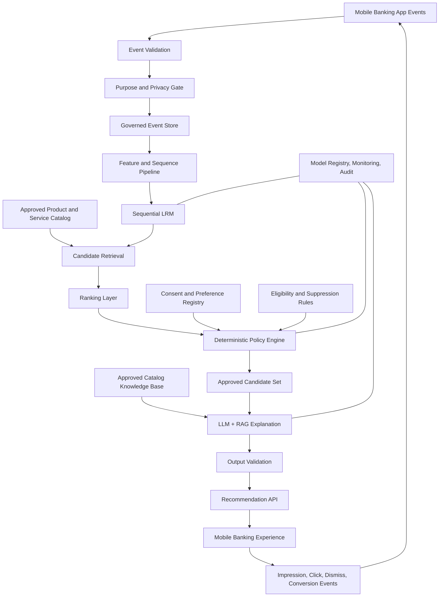

# System Architecture — Target Design

## 1. Logical architecture

## 2. Trust boundaries

- Raw app telemetry must pass validation and purpose checks before it is used for personalization.
- Direct identifiers and authentication secrets are excluded from the recommendation dataset.
- LRM receives minimized behavioral sequences and approved context features.
- Policy engine is deterministic and independent of LRM/LLM outputs.
- LLM receives only approved candidate metadata and approved catalog passages; it does not receive raw event histories or direct customer identifiers.
- LLM output is untrusted until schema and factual validation complete.
- The app receives only approved recommendation payloads.

## 3. Architectural invariants

These hold in every phase and must not be relaxed without an explicit design review.

1. **Purpose metadata is not permission.** An event's `purpose` field describes its intended use; it does not establish that the customer authorized that use. The policy engine evaluates the purpose against the customer's applicable consent and other policy conditions. Missing or ambiguous permission is never treated as implicit permission (fail closed).
2. **Synthetic results are not real-world evidence.** Models learn patterns deliberately embedded in the synthetic generator. Any performance figure must be reported as a synthetic-data result, not as evidence of real customer behavior or real recommendation effectiveness.
3. **Recommendation and policy stay separate.** Models produce candidate recommendations and scores; the deterministic policy layer alone decides which candidates may be shown. No model output can bypass or override a policy decision.

## 4. Model responsibilities

### LRM
- Learn sequential patterns from app navigation and service-use events.
- Retrieve or rank candidate services/products.
- Produce relevance scores, not eligibility decisions.

### LLM
- Explain approved recommendations in clear language.
- Ground claims in approved catalog and product documentation.
- Return schema-constrained output.
- Never invent rates, fees, eligibility, returns, approval likelihood, or product terms.

### Policy engine
- Enforce consent/purpose, eligibility, availability, suppression, frequency caps, and channel restrictions.
- Fail closed if policy status is missing or cannot be evaluated.
- Record policy version and reason codes.

## 5. Local PoC topology

- CSV/Parquet synthetic files.
- DuckDB or pandas for local analytics.
- PyTorch for model experiments.
- FAISS CPU for later retrieval experiments.
- Local LLM runtime only if hardware permits.
- FastAPI and Streamlit for later application phases.
- MLflow local tracking.

## 6. Production migration considerations

Production deployment must be selected with the institution's enterprise architecture and security teams. Possible capabilities include governed lakehouse/object storage, approved event streaming, distributed feature processing, model registry, private model serving, enterprise IAM, KMS/HSM, secrets management, centralized logging, monitoring, disaster recovery, and network segmentation.

This document is a target design, not a deployment authorization or technology mandate.
