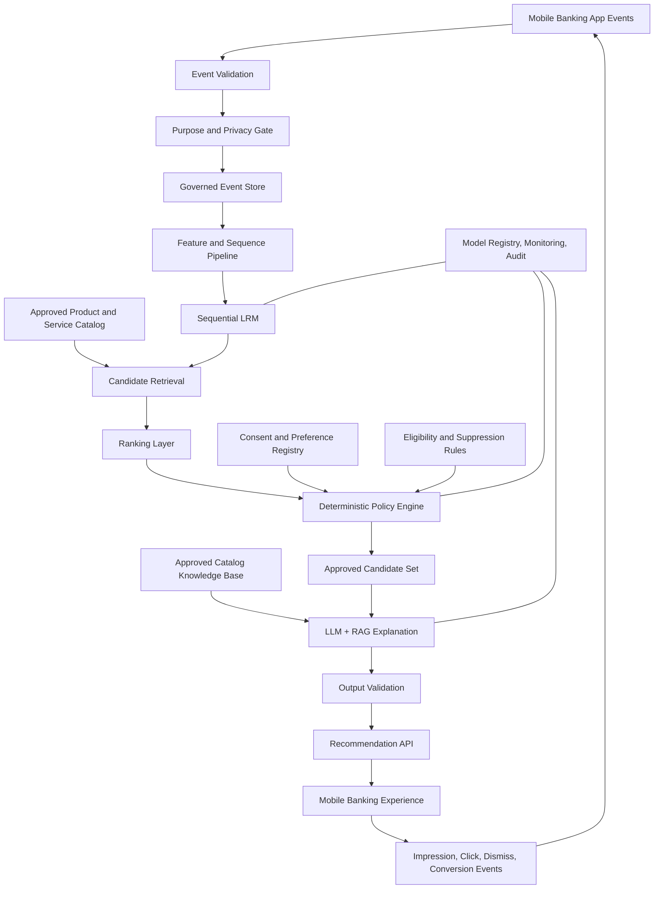
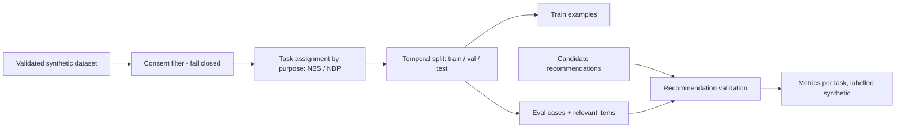
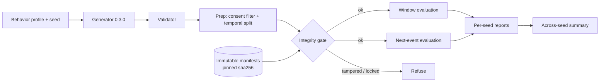
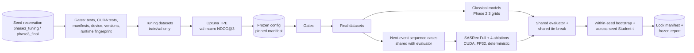

# System Architecture — Target Design

## 1. Logical architecture

## 2. Trust boundaries

- Raw app telemetry must pass validation and purpose checks before it is used for personalization.
- Direct identifiers and authentication secrets are excluded from the recommendation dataset.
- LRM receives minimized behavioral sequences and approved context features.
- Policy engine is deterministic and independent of LRM/LLM outputs.
- LLM receives only approved candidate metadata and approved catalog passages; it does not receive raw event histories or direct customer identifiers.
- LLM output is untrusted until schema and factual validation complete.
- The app receives only approved recommendation payloads.

## 3. Architectural invariants

These hold in every phase and must not be relaxed without an explicit design review.

1. **Purpose metadata is not permission.** An event's `purpose` field describes its intended use; it does not establish that the customer authorized that use. The policy engine evaluates the purpose against the customer's applicable consent and other policy conditions. Missing or ambiguous permission is never treated as implicit permission (fail closed).
2. **Synthetic results are not real-world evidence.** Models learn patterns deliberately embedded in the synthetic generator. Any performance figure must be reported as a synthetic-data result, not as evidence of real customer behavior or real recommendation effectiveness.
3. **Recommendation and policy stay separate.** Models produce candidate recommendations and scores; the deterministic policy layer alone decides which candidates may be shown. No model output can bypass or override a policy decision.

## 4. Model responsibilities

### LRM
- Learn sequential patterns from app navigation and service-use events.
- Retrieve or rank candidate services/products.
- Produce relevance scores, not eligibility decisions.

### LLM
- Explain approved recommendations in clear language.
- Ground claims in approved catalog and product documentation.
- Return schema-constrained output.
- Never invent rates, fees, eligibility, returns, approval likelihood, or product terms.

### Policy engine
- Enforce consent/purpose, eligibility, availability, suppression, frequency caps, and channel restrictions.
- Fail closed if policy status is missing or cannot be evaluated.
- Record policy version and reason codes.

## 5. Offline data preparation and evaluation (Phase 2 foundations)

- The consent filter decides which events may be used to *build training data and
  evaluation sets*. It does not replace the serving-time policy engine.
- Each task reads only events of its own purpose (no cross-purpose features).
- Evaluation rejects malformed or out-of-candidate recommendations rather than
  silently scoring them.
- Details: [08_PHASE_2_FOUNDATIONS_REPORT.md](08_PHASE_2_FOUNDATIONS_REPORT.md).
- Phase 2.1 baselines (popularity, item-item CF, implicit MF) plug into this pipeline:
  parameters are fitted on train, configurations are selected on validation, and test
  is used once for final evaluation with paired bootstrap CIs. Models only produce
  candidate scores; they make no policy decisions. Details:
  [09_PHASE_2_1_BASELINES_REPORT.md](09_PHASE_2_1_BASELINES_REPORT.md).
- Experiment governance: experiments are named suites. Datasets whose test split has
  been used are registered by checksum and can only be re-run with their original
  suite. Frozen benchmark reports live in `benchmarks/`. Phase 2.2 added Personal
  Frequency as the reference baseline: [10_PHASE_2_2_PERSONAL_FREQUENCY_REPORT.md](10_PHASE_2_2_PERSONAL_FREQUENCY_REPORT.md).

### 5.1 Benchmark integrity and robustness experiments (Phase 2.3)

- **Integrity gate** (`bri.experiments.integrity`), run before any evaluation data is
  read: registered suite identifiers must keep their model grids and key comparisons;
  processed files must match their own prep checksums; a dataset belonging to a locked
  benchmark (matched by events checksum or by generator identity) may only be re-run by
  its own suite, with its registered canonical configuration, and with source,
  processed and prep fingerprints identical to the manifest. Manifests are write-once
  and their own sha256 is pinned in code.
- **Generator 0.3.0** exposes behavior profiles (customer affinity concentration and
  task-specific transition probabilities/maps). Generator 0.2.0 is preserved byte for
  byte. Profiles are invented experimental assumptions.
- **Two evaluation protocols share one fit/select/test core**: the seven-day window
  protocol and the next-event protocol (one case per eligible target event, history
  strictly before it, customer-cluster bootstrap). Both keep NBS and NBP separate and
  use the same candidate sets and model interface.
- **Two-level statistics**: within-seed bootstrap CIs describe case/customer variation
  in one dataset; across-seed Student-t intervals describe variation between synthetic
  datasets of one profile. They are never pooled, and profiles are not combined.
- Synthetic robustness results are evidence about the generator regimes only, never
  about real customers. Details: [11_PHASE_2_3_ROBUSTNESS_REPORT.md](11_PHASE_2_3_ROBUSTNESS_REPORT.md).

### 5.2 Sequential recommendation experiment (Phase 3)

- **Separation of tuning and final evaluation.** Seeds are reserved per namespace in a
  pinned manifest before any data exists. Hyperparameters are searched on tuning
  validation splits only, then frozen in a pinned manifest before the first final
  dataset is generated. Final test splits are used once and locked.
- **One case protocol.** Sequence cases are the next-event cases of the evaluator,
  also built for the train window. Tie, repeat, session and cold-start rules are
  shared. History is strictly before the target. Session-boundary features come only
  from the historical prefix, and the within/cross-session label is evaluator-only.
- **Runtime as part of the experiment identity.** The device, GPU, CUDA/cuDNN/torch
  build, CPU threads and determinism settings form a runtime fingerprint recorded at
  the freeze. A final run on a different runtime is refused instead of mixed.
- **Recommendation stays separate from policy.** SASRec only produces candidate
  scores, exactly like the classical models. It makes no eligibility, consent or
  policy decisions.
- Details and results: [12_PHASE_3_SEQUENTIAL_REPORT.md](12_PHASE_3_SEQUENTIAL_REPORT.md).

## 6. Local PoC topology

- CSV/Parquet synthetic files.
- DuckDB or pandas for local analytics.
- PyTorch (2.11.0, optional `seq` extra; CUDA or CPU) for sequential model experiments; Optuna (4.9.0) for validation-only hyperparameter search.
- FAISS CPU for later retrieval experiments.
- Local LLM runtime only if hardware permits.
- FastAPI and Streamlit for later application phases.
- MLflow local tracking.

## 7. Production migration considerations

Production deployment must be selected with the institution's enterprise architecture and security teams. Possible capabilities include governed lakehouse/object storage, approved event streaming, distributed feature processing, model registry, private model serving, enterprise IAM, KMS/HSM, secrets management, centralized logging, monitoring, disaster recovery, and network segmentation.

This document is a target design, not a deployment authorization or technology mandate.
