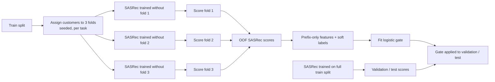

# Phase 3.1 — Hybrid Recommendation: Experiment Design (REVISION 4, approved for pre-registration)

> Design and pre-registration draft. No code, seeds, datasets, or results exist for
> Phase 3.1. Everything here is fixed **before** any Phase 3.1 data is generated. All
> future results will be synthetic-data experiments for a fictional Indonesian
> commercial bank's mobile banking application, run in a local research environment.

Decision status: decisions 1–15 (§11) were approved by the project owner on 2026-11-10.
This revision is the one whose sha256 is recorded in the pre-registration manifest
`benchmarks/manifests/phase3_1-prereg.json`. Any later change requires a new
pre-registration, never an edit of the pinned one.

## 1. Motivation

Phase 3 (`docs/12_PHASE_3_SEQUENTIAL_REPORT.md`) found that SASRec Full beats Personal
Frequency (PF) clearly only on `transition_dominant` / NBS, and almost entirely on
within-session targets. PF stays as good or better on cross-session targets and in the
habit and balanced regimes. Phase 3.1 asks whether a hybrid can keep PF's strength
where behavior recurs and add SASRec's strength where short-term transitions dominate.
A valid outcome is that the hybrid only adds complexity.

## 2. Research questions

- **RQ1 (non-inferiority where PF is strong).** Is the hybrid no worse than PF in the
  four habit and balanced groups?
- **RQ2 (superiority where transitions dominate).** On transition / NBS, does the
  hybrid beat PF and stay non-inferior to SASRec Full?
- **RQ3 (does the gate earn its complexity).** Does gated fusion beat static fusion?
- **RQ4 (cost).** What is the added cost (training including OOF, inference, memory,
  parameters)?

## 3. Feature protocol: Option A, prefix history only

### 3.1 Why time features are excluded

In the offline next-event protocol, the recommendation is evaluated at the target
event's timestamp. Measured on the validation split of one Phase 3 *tuning* dataset
(`transition_dominant`, seed 20261120; no final or test data touched):

> The rule "minutes since the last history event < 30" agrees with the evaluator's
> within-session label on **100.00%** of validation cases (NBS 1,412, NBP 248).
> Within-session gaps are ≤ 6.7 minutes and cross-session gaps ≥ 30.7 minutes, because
> the generator separates sessions by ≥ 30 minutes.

Time-to-target and "active session" features are therefore the evaluator's label in
disguise. Option B, an explicit request-time protocol, is deferred to separate
research.

### 3.2 Features (fixed, 9 in total)

All features come from the case's history prefix (steps strictly before the target)
and from the two models' distributions over the task's candidate set C (§4.1).
Entropy is normalized by `log|C|`, so it lies in [0, 1] whatever the candidate-set
size.

| Group | Feature | Definition |
|---|---|---|
| **P** (PF) | `pf_top` | max_i P_PF(i) |
| | `pf_entropy` | −Σ P_PF(i) log P_PF(i) / log\|C\| |
| | `pf_margin` | top-1 − top-2 of P_PF |
| **S** (SASRec) | `sas_top` | max_i P_SASRec(i) |
| | `sas_entropy` | −Σ P_SASRec(i) log P_SASRec(i) / log\|C\| |
| | `sas_margin` | top-1 − top-2 of P_SASRec |
| **H** (history structure) | `h_sessions` | number of distinct historical sessions in the represented history |
| | `h_last_session_steps` | steps in the most recent historical session |
| | `h_last_session_share` | `h_last_session_steps` / total represented steps |

Historical sessions are delimited only by the history-only boundary flags of Phase 3:
a boundary is a represented step that starts a session different from the previous
represented step, and the earliest represented step is never a boundary. No feature
is added, removed or redefined after any Phase 3.1 validation result is seen.
Correlations between features are reported as diagnostics only and never used to drop
features.

### 3.3 Forbidden inputs (enforced by tests)

- the target timestamp, or any difference relative to it;
- the target's session id, or any boundary derived from the target;
- events at or after the recommendation time;
- the evaluator's within/cross-session label (oracle diagnostic only, §6);
- the behavior profile, seed, or any dataset or generator-regime identity.

There are no per-profile parameters anywhere: α and the gate are per **task** (NBS,
NBP) and shared by all profiles.

### 3.4 Fitted transforms

The only fitted transform is the gate's feature standardization, fitted on the
train-split OOF features of the dataset being processed and applied unchanged to its
validation and test cases.

## 4. Models

### 4.1 Score normalization (no fitted parameters)

For each case, over the task's candidate set C:

- `P_PF(i) = (count(i) + 1) / (Σ_j count(j) + |C|)`, a Laplace-smoothed history
  distribution;
- `P_SASRec(i) = exp(s_i) / Σ_{j∈C} exp(s_j)`, the softmax of SASRec logits.

There is no temperature scaling for SASRec and no tuned smoothing for PF in Phase 3.1.
PF, SASRec, static fusion and gated fusion use the **identical candidate set in the
identical deterministic order** (sorted item ids) for every evaluation case, and this
is asserted at runtime. Ties in fused scores use the shared tie-break (train
popularity, then item id).

### 4.2 Candidates

| Model | Definition | Selected on |
|---|---|---|
| Personal Frequency | Phase 2.3 grid (signal) | per dataset, validation (as before) |
| SASRec Full | **Phase 3 frozen configuration (trial 21)**; no SASRec HPO | — |
| Static fusion | `P = (1 − α) P_PF + α P_SASRec`; one α per task, α ∈ {0.0, 0.1, …, 1.0} | tuning validation, macro-average NDCG@1 over the six groups |
| Gated fusion | `P(i \| x) = (1 − α(x)) P_PF(i) + α(x) P_SASRec(i)`, `α(x) = σ(wᵀx + b)` | feature subset ∈ {P, S, H, P+S, P+S+H} × C ∈ {0.01, 0.1, 1, 10} on tuning validation, same objective; weights refitted per dataset on its train split |
| Oracle router (diagnostic) | SASRec on evaluator-labelled within-session cases, PF on cross-session cases | never selected; reported separately |

`α = 0` and `α = 1` are in the grid, so static fusion can fall back to pure PF or pure
SASRec. The selection objective for α and the gate is NDCG@1 (the primary metric),
whereas the Phase 3 SASRec HPO used NDCG@3. This is deliberate: SASRec's frozen
configuration is not re-tuned.

### 4.3 Gate training target: soft labels

On each train-split case, with OOF SASRec scores (§4.4):

| Condition | Target y |
|---|---|
| NDCG@1(SASRec) > NDCG@1(PF) | 1 |
| equal | 0.5 |
| NDCG@1(SASRec) < NDCG@1(PF) | 0 |

Ties are kept, because they are part of the operational distribution. The gate is
fitted by L2-regularized binary cross-entropy with fractional targets:

`minimize  Σ_n BCE(y_n, σ(wᵀx_n + b)) + ‖w‖² / (2C)`

- the bias is unregularized;
- a deterministic full-batch Newton method in float64 (numpy), at most 100
  iterations, stopping when the gradient's max-norm is ≤ 1e-10, starting from w = 0,
  b = 0;
- implemented in the project, not with a standard binary-only classifier;
- tested against a hand-computed small example and for invariance to case order.

**Methodological limitation:** this target is a proxy for "when does SASRec tend to
win", not the mathematically optimal objective for choosing a fusion weight. It is
stated as such in the report.

### 4.4 Customer-level cross-fitting (3-fold OOF)



- Folds are disjoint **customer** sets: a fold excludes all cases of its customers.
  Assignment per dataset and task: the task's train-split customers are sorted by
  token, permuted with `numpy.random.default_rng(3101)`, and dealt round-robin into
  folds 0, 1, 2.
- OOF SASRec models use the frozen configuration and the same validation-only early
  stopping as Phase 3. Validation and test scores come from one SASRec trained on the
  full train split, as in Phase 3.
- Known caveat (reported, not corrected): OOF models see two thirds of the customers,
  so their scores may be slightly less confident than the full model's.

### 4.5 Gate support rule (no silent fallback)

Support is checked per dataset, task and initialization seed, on every fold. Class
counts use only `y = 0` and `y = 1`; ties (`y = 0.5`) are counted and reported
separately and never counted as either class.

| Minimum over folds of min(#y=0, #y=1) | Status |
|---|---|
| ≥ 50 | **valid**: the gate is fitted and evaluated normally |
| 30–49 | **low-support exploratory**: fitted and reported, but cannot count towards RQ3 |
| < 30 | **refused**: the gate is not fitted; reported as "not evaluable per protocol" |

If support is insufficient, the protocol is **not** adapted. The number of folds, the
regularization, the target definition and the feature set are never changed to make a
gate fit. The insufficiency is reported.

For every dataset, task, initialization seed and fold, the report lists the counts of
y = 0, y = 0.5 and y = 1, the within/cross-session case counts (train split,
diagnostic only), and the distribution of fitted α(x) on validation and test (mean,
SD, 5th/50th/95th percentiles). A near-constant α(x) shows a gate that does not route.

## 5. Choosing the primary hybrid (validation only)

The primary hybrid used for RQ1 and RQ2 is chosen on **tuning validation**, frozen,
and never changed after final results:

1. Select α (static) and the feature subset and C (gated) on tuning validation.
2. Choose *gated* as the primary hybrid if both hold, otherwise *static*:
   (a) every tuning dataset × task × initialization gate is **valid** (≥ 50 of each
   class on every fold); and
   (b) `Δ_val = (1/6) Σ_{g=1..6} (NDCG@1_gated,g − NDCG@1_static,g) > 0` on tuning
   validation.

   Each group g (profile × task) weighs 1/6 regardless of case counts, and
   NDCG@1_·,g is the group's mean over its tuning datasets. Δ_val is computed after
   α, the feature subset and C are all selected. No confidence interval is used here:
   with 3 tuning seeds per profile it would be too wide to be a useful selection
   criterion.
3. Freeze the choice, α, the feature subset and C in `phase3_1-config`.
4. Evaluate on the final seeds. Static and gated are both reported on final as
   additional analysis, but only the pre-chosen primary hybrid is used for the main
   RQ1/RQ2 claims.

Choosing *gated* on validation is **not** evidence for RQ3. RQ3 is tested
independently on the final seeds (§8), and its outcome is reported. It does not switch
the primary hybrid after the fact.

## 6. Oracle router (diagnostic only)

The oracle router reads the evaluator's label, so it is not deployable. It is reported
in a separate table labelled *diagnostic upper bound*. It never enters selection and is
never quoted as hybrid performance. It distinguishes two failure modes:
1. PF and SASRec are not complementary enough (oracle ≈ best single model).
2. They are complementary, but the prefix does not reveal when to use which (oracle ≫
   gate ≈ static).

## 7. Data, seeds and initialization

- New namespaces `phase3_1_tuning` (3 seeds per profile, 9 datasets) and
  `phase3_1_final` (10 seeds per profile, 30 datasets). They are reserved only after
  the pre-registration manifest is pinned and verified, collision-checked against every
  registered seed including all Phase 3 seeds, and refused by other runners.
- Same generator 0.3.0 profiles, 500 customers, 30 days, split 16/7/7, consent
  filtering, NBS/NBP separation, and the Phase 3 next-event case protocol.
- Phase 3 datasets are not reused. The Phase 3 final splits are a locked baseline, not
  a validation set.
- **Three SASRec initialization seeds, {1, 2, 3}**, separate from dataset seeds
  (seed 1 is the Phase 3 training seed). The same three
  are used by every SASRec-based component (full, OOF, static, gated), so PF, SASRec
  and hybrid comparisons are paired.

### 7.1 Analysis structure

```
dataset seed
  ├── initialization 1 ┐
  ├── initialization 2 ├─> per-case mean over the 3 initializations -> metric per dataset seed
  └── initialization 3 ┘
                                     |
                                     v
                     across-dataset-seed analysis (Student-t over 10 seeds)
                     within-seed paired customer bootstrap (on the per-case means)

initialization variance: reported separately (per-dataset SD over the 3 runs, averaged)
```

Initializations are never treated as additional dataset seeds, and their variance is
never merged into the bootstrap or across-seed intervals. PF has no initialization;
the same PF scores pair with each initialization.

## 8. Evaluation and pre-registered criteria

Primary metric NDCG@1. Primary protocol next-event; secondary 7-day window with no
window-specific tuning (α and the gate are never selected on window metrics). Paired
customer-level bootstrap within each dataset seed and across-seed Student-t intervals
are reported separately, as in Phase 3.

| RQ | Criterion (final test, across-seed 95% interval) |
|---|---|
| RQ1 | Lower bound of (primary hybrid − PF) > **−0.01** in **each** of habit/NBS, habit/NBP, balanced/NBS, balanced/NBP |
| RQ2 | Transition/NBS: (primary hybrid − PF) interval entirely > 0 **and** lower bound of (primary hybrid − SASRec Full) > **−0.01** |
| RQ3 | Macro-average over the six groups of (gated − static) has an interval entirely > 0, per-group differences reported. Confirmatory only if every final dataset × task × initialization gate is **valid**; otherwise RQ3 is reported as "not satisfiable per protocol", with the affected cells listed |
| RQ4 | Report training time (including the 3 OOF trainings), inference latency, peak GPU memory, parameter count. No winning requirement |

Final-evaluation gate status (per dataset × task × initialization):

| Final gate support | Treatment |
|---|---|
| ≥ 50 per class on every fold | valid: enters confirmatory evaluation |
| 30–49 per class on some fold | exploratory: reported, excluded from confirmatory claims |
| < 30 per class on some fold | refused: gate not fitted; "not evaluable per protocol" |

If the primary hybrid is *gated* and a final cell's gate is not valid, the primary
hybrid is not confirmatory for that cell. The cell is listed, and the RQ1/RQ2 criteria
for its group are reported as not evaluable per protocol. There is no fallback to
static fusion after final evaluation.

Interpretation, fixed in advance:

| Outcome | Conclusion |
|---|---|
| RQ1 and RQ2 met | Hybrid achieves the main goal |
| RQ2 met, RQ1 failed | Trade-off, not an overall success |
| RQ1 met, RQ2 failed | Safe for habit/balanced, but sequential value not shown |
| RQ3 failed or not satisfiable | Static fusion is the simpler, preferred approach |
| Neither fusion beats PF anywhere | No case for a hybrid as the main model |

## 9. Integrity and pre-registration lock

- At Phase 3.1 Checkpoint 0, everything in §3–§8 and §11 is written to a structured
  pre-registration manifest (`benchmarks/manifests/phase3_1-prereg.json`): features,
  normalization, grids, gate objective and optimizer settings, support thresholds,
  the selection rule, criteria and margins. It also records the sha256 of this design
  document at approval. Its sha256 is pinned and verified before any seed is
  reserved.
- Then come `phase3_1-seeds`, `phase3_1-config` (frozen α, primary-hybrid choice,
  feature subset, C) and `phase3_1` (final lock), with the same gate sequence as
  Phase 3 (tests, CUDA tests, manifests, device, namespace, versions, runtime
  fingerprint), and a frozen report plus derived summary.
- Phase 3 manifests, pins and frozen artifacts are never modified.

## 10. Rough cost (current laptop GPU)

Final: 30 datasets × 2 tasks × 3 initializations × 4 SASRec trainings (3 OOF + 1
full) = 720 fits at about 8 s each, roughly 1.6 h. Tuning: 9 × 2 × 3 × 4 = 216 fits,
under 1 h. Gate fitting and the α / feature-subset / C grids are negligible.

## 11. Decisions

| # | Decision | Status |
|---|---|---|
| 1 | Option A (prefix-only features); Option B deferred | decided |
| 2 | Oracle router as a diagnostic upper bound only | decided |
| 3 | Customer-level 3-fold OOF on the train split for gate training | decided |
| 4 | Non-inferiority margin 0.01 NDCG@1 | decided |
| 5 | ≥ 3 SASRec initialization seeds; analysis structure §7.1 | decided |
| 6 | Window secondary, no window-specific tuning | decided |
| 7 | Laplace PF + softmax SASRec, no fitted normalizers, no temperature or smoothing tuning, identical deterministic candidate sets | decided |
| 8 | Soft-label gate target (1 / 0.5 / 0), L2 BCE with fractional targets, proxy limitation stated | decided (revised) |
| 9 | No per-profile parameters or profile/dataset features; α and gate per task | decided |
| 10 | Fixed 9 features (§3.2); subsets P, S, H, P+S, P+S+H; C {0.01, 0.1, 1, 10}; α step 0.1; selection on tuning validation by macro NDCG@1 | decided |
| 11 | Gate support: ≥ 50 valid, 30–49 exploratory (not RQ3), < 30 refused; ties counted separately; no silent protocol changes | decided |
| 12 | Primary hybrid chosen on tuning validation and frozen; static and gated both reported on final | decided |
| 13 | Per-case mean over initializations per dataset seed, then across-seed analysis; initialization variance separate | decided |
| 14 | Gated iff all tuning gates valid and Δ_val > 0 (equal-weight macro NDCG@1, after all selections); otherwise static; not evidence for RQ3 | decided |
| 15 | Final gates: ≥ 50 confirmatory, 30–49 exploratory, < 30 refused; non-valid cells listed as not evaluable per protocol; no fallback to static | decided |
